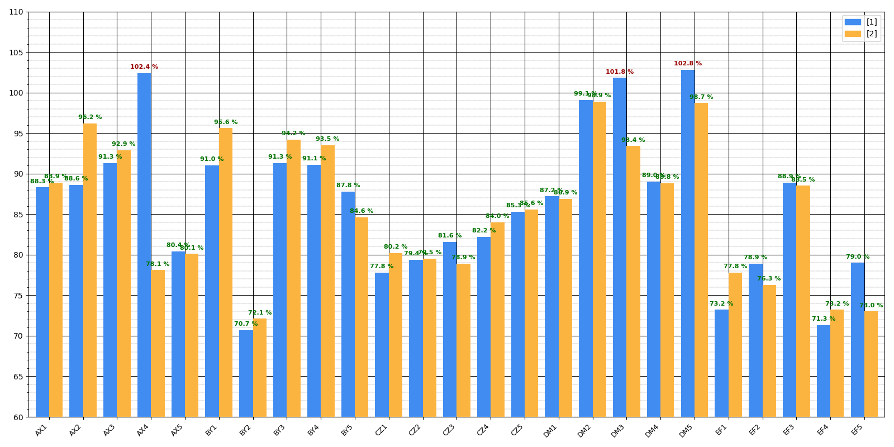

# Load Chart Analyzer: Reading Engineering Bar Charts with Computer Vision

A Python tool that reads **images** of engineering load bar charts, recovers the numeric value of every bar, and writes the analysis paragraphs an engineer would otherwise write by hand: which sensors exceed the design limit, the largest increases and decreases between two model versions, and trends per sensor group.

Developed in 2026 by a team of four students, including André Baptista ([@andrefb26](https://github.com/andrefb26)), for an engineering consulting company during **JuniFEUP's GENESIS** programme (FEUP, University of Porto). The project received the **"Ready to Launch"** distinction.

> This is a sanitised public copy: the client is not named, and every chart in [`samples/`](samples) is **synthetic**, generated with random values and fictional sensor names. None of the client's data is included.

<p align="center"></p>

## What it does

Load reports often contain dozens of bar charts comparing a *current* model with a *baseline*, each bar being a sensor's load as a percentage of its design value. Reading them and writing the comments is slow and error-prone. Given a chart image, the tool runs this pipeline:

1. **Locate the plot area** and crop it (OpenCV).
2. **Recover the axis scale** from the grid lines: pixels per tick and the y-coordinate of the baseline.
3. **Read the sensor names** on the x-axis with OCR (Tesseract).
4. **Detect the bars of each data series** by colour, using HSV masks (configurable in `Graphconfig.py`), and convert each bar's height in pixels into a percentage.
5. **Choose the analysis mode automatically:**
   - two series → *comparison* mode (current vs. baseline);
   - one series → *study* mode (tabular output only).
6. **Generate the comments** (`GraphComments.py`):
   - exceedances above 101 %;
   - the top 5 increases and decreases;
   - differences under 1 % treated as calculation uncertainty;
   - sensors missing from one of the versions;
   - group trends based on the sensor-name prefix (e.g. "all AX sensors show load increases").

## Usage

Requirements: Python 3.12+, and [Tesseract OCR](https://github.com/tesseract-ocr/tesseract) installed. On Windows the default path `C:\Program Files\Tesseract-OCR` is used.

```bash
pip install -r requirements.txt
python main.py                              # uses samples/comparison.png
python main.py samples/study.png            # single series → study mode
python main.py path/to/your_chart.png
```

## Project structure

```
main.py             pipeline and command-line interface
Graphcalculate.py   image processing: cropping, axis scale, OCR of labels, bar detection
Graphconfig.py      chart configuration: axis minimum, tick step, HSV colour ranges per series
GraphComments.py    generation of the analysis text
samples/            synthetic example charts
```

## My contribution

I restructured the analysis flow in `main.py`:
- the analysis mode is now chosen automatically from the number of colour series detected;
- in comparison mode, only the two selected series are processed;
- bar values are computed from the bar height.

I also reworked the generated comments so that each statement names the data series it refers to, and made the final adjustments to the image processing for the delivered version.

## Technologies

Python · OpenCV · NumPy · Tesseract OCR (pytesseract)
